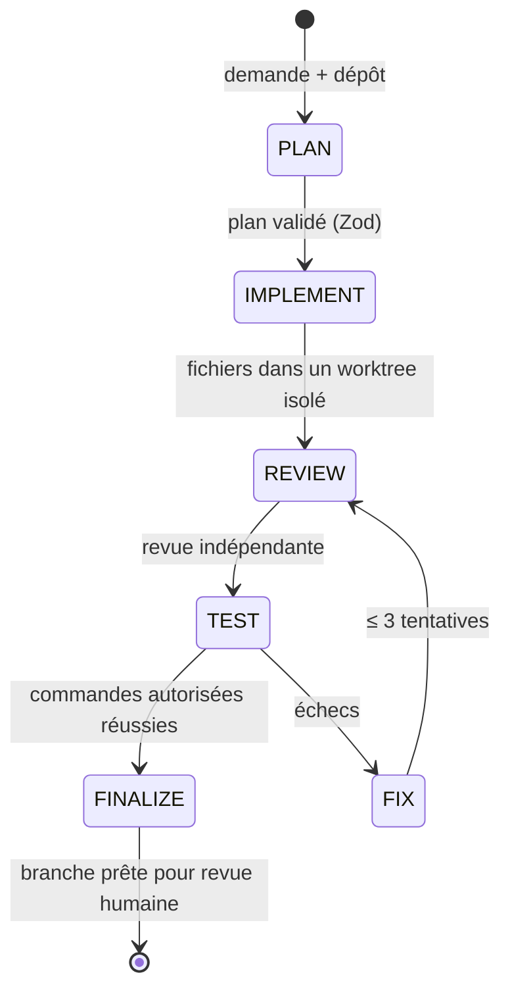

# Plateforme de développement multi-agent (LLM locaux)

**Deux LLM locaux qui planifient, codent, relisent et testent une modification dans un Git worktree isolé — puis remettent une branche vérifiable à un humain.** GPT-OSS 20B et Qwen 3.6 27B coopèrent via une machine à états explicite, avec commandes en sandbox, sorties validées par schéma et un benchmark de 50 tâches.

[](https://github.com/Matt95354855/multi-agent/actions/workflows/ci.yml)    

[English](README.md) · [Français](README.fr.md)

## Points forts

- **Orchestration déterministe** : `PLAN → IMPLEMENT → REVIEW → TEST → FIX → FINALIZE`, trois corrections au plus ; chaque sortie Planner / Coder / Reviewer est validée par Zod — aucune transition ne dépend d'un texte libre.
- **Sûr par défaut** : écritures désactivées sans `--approve-write` ; commandes en liste blanche exacte, lancées sans shell dans un conteneur Docker verrouillé ; garde-fous de chemins, liens symboliques, tailles et délais ; traces expurgées.
- **Gestion des modèles selon les ressources** : un seul `llama-server` géré à la fois, arrêt contrôlé avant bascule, contrôle de santé et seuils RAM/VRAM.
- **Reprise et idempotence** : checkpoints JSON atomiques, empreintes SHA-256 des changements, `resume` après interruption.
- **Banc d'évaluation** : 50 tâches déterministes (bugs, refactoring, tests, fonctionnalités, multi-fichiers, sécurité) avec assertions cachées, comparant GPT-OSS seul, Qwen seul et la collaboration.
- Aucune fusion automatique : la publication exige `--approve-external` et ouvre seulement une pull request.

## Architecture



Construit sur [Harness](https://github.com/Matt95354855/Harness) (épinglé en sous-module Git, non modifié).

## Démarrage rapide

```bash
git clone --recurse-submodules https://github.com/Matt95354855/multi-agent.git
cd multi-agent
npm ci && npm run bootstrap:harness
npm run doctor                     # diagnostic, sans modèle
npm run dev -- run --repo ../mon-app --request "Corrige le bug et ajoute les tests" \
  --approve-write --branch agent/fix-bug
```

## Structure du dépôt

```text
src/orchestrator/  machine à états, budgets, boucle de correction, reprise
src/agents/        affectation des rôles et validation JSON
src/models/        cycle de vie llama.cpp, surveillance des ressources, métriques
src/workspace/     worktrees, écritures bornées, diffs, validations
src/security/      politiques de chemins, commandes et expurgation
src/evaluation/    corpus de 50 tâches et rapports comparatifs
tests/             tests unitaires et d'intégration (modèles simulés en CI)
docs/              architecture, modèle de sécurité, benchmarks, guide Windows
```

## État et limites

La logique hors ligne et les modèles simulés sont testés en CI ; **aucun résultat GPU réel n'est encore publié** — les rapports signalent explicitement les exécutions simulées (`simulated: true`). Le garde-fou Node.js n'est pas un sandbox système : exécuter les tâches non fiables dans une VM ou un conteneur verrouillé. Voir [sécurité](docs/security.md) et [benchmarks](docs/benchmarks.md).

## Documentation

[Guide détaillé](docs/GUIDE.fr.md) · [Architecture](docs/architecture.md) · [Modèle de sécurité](docs/security.md) · [Benchmarks](docs/benchmarks.md) · [Dépannage](docs/troubleshooting.md)

## Licence

MIT — voir [LICENSE](LICENSE).
