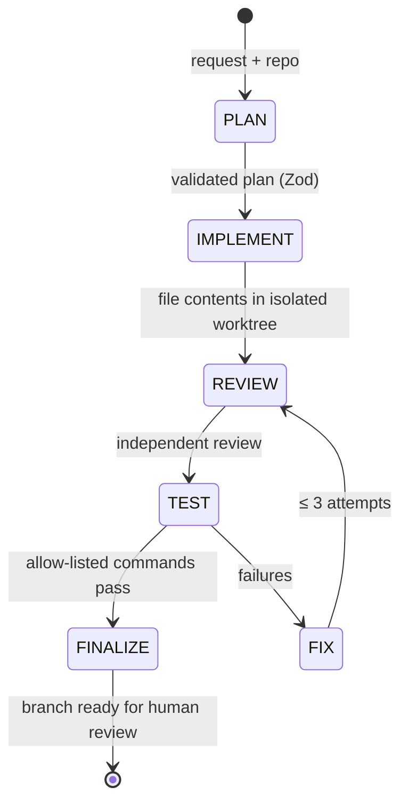

# Local LLM Coding Agents

**Two local LLMs that plan, code, review and test a change in an isolated Git worktree — then hand a verifiable branch to a human.** GPT-OSS 20B and Qwen 3.6 27B cooperate through an explicit state machine, with sandboxed commands, schema-validated outputs and a 50-task benchmark.

[](https://github.com/Matt95354855/local-llm-coding-agents/actions/workflows/ci.yml)    

[English](README.md) · [Français](README.fr.md)

## Highlights

- **Deterministic orchestration**: `PLAN → IMPLEMENT → REVIEW → TEST → FIX → FINALIZE`, at most three fix rounds; every Planner / Coder / Reviewer output is validated with Zod — no transition depends on free text.
- **Safe by default**: writes disabled without `--approve-write`; exact-match command allow-list run without a shell inside a locked Docker container; path, symlink, size and timeout guards; redacted traces.
- **Resource-aware model management**: one managed `llama-server` at a time, controlled shutdown before switching, health checks and RAM/VRAM thresholds.
- **Resumable and idempotent**: atomic JSON checkpoints, SHA-256 change fingerprints, `resume` after interruption.
- **Benchmark harness**: 50 deterministic tasks (bugs, refactoring, tests, features, multi-file, security) with hidden assertions, comparing GPT-OSS alone, Qwen alone and collaboration.
- Never merges on its own: publishing requires `--approve-external` and only opens a pull request.

## Architecture



Built on top of [Harness](https://github.com/Matt95354855/llm-agent-harness) (pinned as a Git submodule, unmodified).

## Quick start

```bash
git clone --recurse-submodules https://github.com/Matt95354855/local-llm-coding-agents.git
cd local-llm-coding-agents
npm ci && npm run bootstrap:harness
npm run doctor                     # diagnostics, no model required
npm run dev -- run --repo ../my-app --request "Fix the bug and add tests" \
  --approve-write --branch agent/fix-bug
```

## Repository structure

```text
src/orchestrator/  state machine, budgets, fix loop, resume
src/agents/        role assignment and JSON validation
src/models/        llama.cpp lifecycle, resource monitoring, metrics
src/workspace/     worktrees, bounded file writes, diffs, validations
src/security/      path, command and redaction policies
src/evaluation/    50-task corpus and comparative reports
tests/             unit and integration tests (simulated models in CI)
docs/              architecture, security model, benchmarks, Windows guide
```

## Status and limitations

Offline logic and simulated models are tested in CI; **no real GPU benchmark results are published yet** — reports flag simulated runs explicitly (`simulated: true`). The Node.js guard is not an OS sandbox: run untrusted tasks in a VM or locked container. See [security](docs/security.md) and [benchmarks](docs/benchmarks.md).

## Documentation

[Detailed guide (FR)](docs/GUIDE.fr.md) · [Architecture](docs/architecture.md) · [Security model](docs/security.md) · [Benchmarks](docs/benchmarks.md) · [Troubleshooting](docs/troubleshooting.md)

## License

MIT — see [LICENSE](LICENSE).
